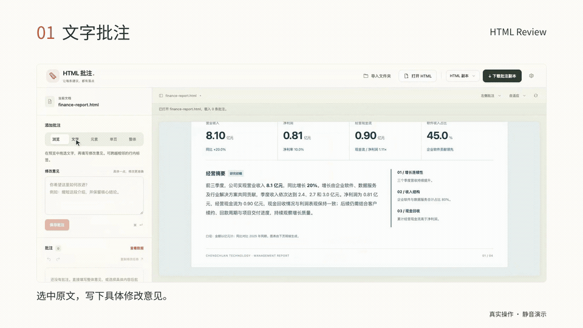

# HTML Review

## Point to the problem. Give your agent the context to change it.

Open an HTML page and leave feedback on the rendered text, images or cards. HTML Review preserves **the original content, target and surrounding context** for a person or coding agent. Reload the updated source, check the result and continue the review.

**[Try it now →](https://king-a23.github.io/html-review/app.html?demo=1)** · **[Download one HTML file ↓](https://github.com/King-A23/html-review/releases/download/v0.1.0/html-review.html)** · [Website](https://king-a23.github.io/html-review/)

Download the file and open it in your browser. No installation, account, server or AI configuration is required. **The interface is currently in Chinese.** Modern desktop browsers on Windows, macOS and Linux are supported; Chrome or Edge is recommended.

[Watch the full demo video](https://king-a23.github.io/html-review/media/launch.mp4) · [Sharing cover](docs/media/social-preview.png) · [中文](README.md) · [Quick start](docs/QUICKSTART.md) · [Windows guide](docs/WINDOWS.md)

## Feedback with a target

| What needs changing | How to identify it |
| --- | --- |
| A sentence | Select the text and describe the replacement. |
| An image, button or card | Click the element; select its parent container if needed. |
| One existing slide or print page | Select the page block already present in the HTML. |
| The whole document | Describe the structure or layout change and its conditions. |

Annotations retain the selected content, nearby context and DOM clues to distinguish repeated text or similar sections. After a source change, locating an annotation reports confirmed, ambiguous or missing targets so you can check the match.

## Start in three steps

1. **Open a page.** [Try the example](https://king-a23.github.io/html-review/app.html?demo=1), or download the tool and click **打开 HTML**. Use **导入文件夹** for local images, styles or scripts.
2. **Add feedback.** Choose **文字** (text), **元素** (element), **单页** (existing page) or **整体** (whole document), then click **保存批注**. For example: “Align this card’s button with the other buttons; keep its title and colors.”
3. **Hand it off and check the result.** Click **下载批注副本** to keep your review. Use **复制修改任务** to copy an agent task, and provide the original HTML and resources. After the change, click **重载页面** and import the completion results.

The tool reads the original file without overwriting it and does not call an agent automatically. Open a downloaded `.review.html` directly to continue editing. Local browser recovery helps with drafts; download a copy for long-term retention or another device.

## Save and hand off

| Export | Use |
| --- | --- |
| `.review.html` | Complete editable copy with the tool, source, imported resources and annotations. Open it directly. |
| `.review.html.gz` | Compressed complete copy. Extract before opening. |
| `.review.json` | Lightweight annotations for an agent. Provide the source and resources alongside it; it cannot restore a workspace by itself. |

Agents can use `scripts/inspect_review.py` to extract annotations and check the source version, then `scripts/update_review.py` to return results by annotation ID. Read the extracted data rather than placing the full copy or Base64 in the agent’s context. Reloading an associated folder also reads its matching result file; manual result import is available. Updated feedback becomes pending again, and old results cannot close newer feedback.

[Handoff prompt](AGENT_PROMPT.md) · [Result protocol](docs/AGENT_RESULTS.md) · [Data and target reference](docs/REFERENCE.md#下载的副本包含什么) — detailed guides are in Chinese.

## Supported pages and limits

The main target is **self-contained HTML**, including local relative CSS, images and scripts imported from a folder. Import trusted HTML only: page scripts can run and network resources may make requests. Choose a folder containing only the intended files; sharing the review copy shares those bundled resources too.

- Original HTML: **20 MiB**. Folder: **50 MiB / 500 files**, with **40 MiB** per resource. Review HTML reimport: **100 MiB**.
- Server APIs, ES module dependencies, nested iframes, cross-page navigation and apps requiring the original origin may not reproduce fully. Folder import does not start a server or build a project.
- Page mode requires existing page blocks. Image text, canvas, Shadow DOM and cross-iframe content cannot be targeted like ordinary DOM text.
- Chrome and Edge can retain read-only source associations through the file picker; other browsers may ask you to select files again on reload. Local recovery depends on browser storage, keeps the latest workspace per tool address and does not provide collaborative editing.

See the [full reference](docs/REFERENCE.md) for encoding, resource handling, shortcuts, saving behavior and positioning limits.

## Documentation and examples

[Quick start](docs/QUICKSTART.md) · [Windows / PowerShell](docs/WINDOWS.md) · [Full reference](docs/REFERENCE.md) · [Verification](VERIFICATION.md) · [v0.1.0 release notes](docs/releases/v0.1.0.md)

Examples: [standalone page](examples/demo.html) · [existing pages](examples/pages.html) · [local resources](examples/with-assets/index.html) · [editable review copy](examples/demo.review.html)

The public beta is **v0.1.0**. For the offline bundle, scripts and checksums, use the [ZIP](https://github.com/King-A23/html-review/releases/download/v0.1.0/html-review-v0.1.0.zip), [SHA256SUMS.txt](https://github.com/King-A23/html-review/releases/download/v0.1.0/SHA256SUMS.txt) or [GitHub Releases](https://github.com/King-A23/html-review/releases/tag/v0.1.0).

## Development and feedback

Development requires Node.js 20+ and Python 3.8+; the standalone tool requires neither. Run `npm ci`, then `npm run build`, `npm run check` and `npm test`. Rebuild and commit `index.html` with source changes. Browser suites and the optional CLI are documented in the [development reference](docs/REFERENCE.md#开发与测试). GitHub Actions checks Windows and Linux with Node 20 and 24; Windows also checks workflows in Microsoft Edge.

[MIT license](LICENSE). v0.1.0 is a public beta; the interface and data APIs may evolve. Report issues through [GitHub Issues](https://github.com/King-A23/html-review/issues) with your browser version, reproduction steps and a shareable minimal HTML example.
