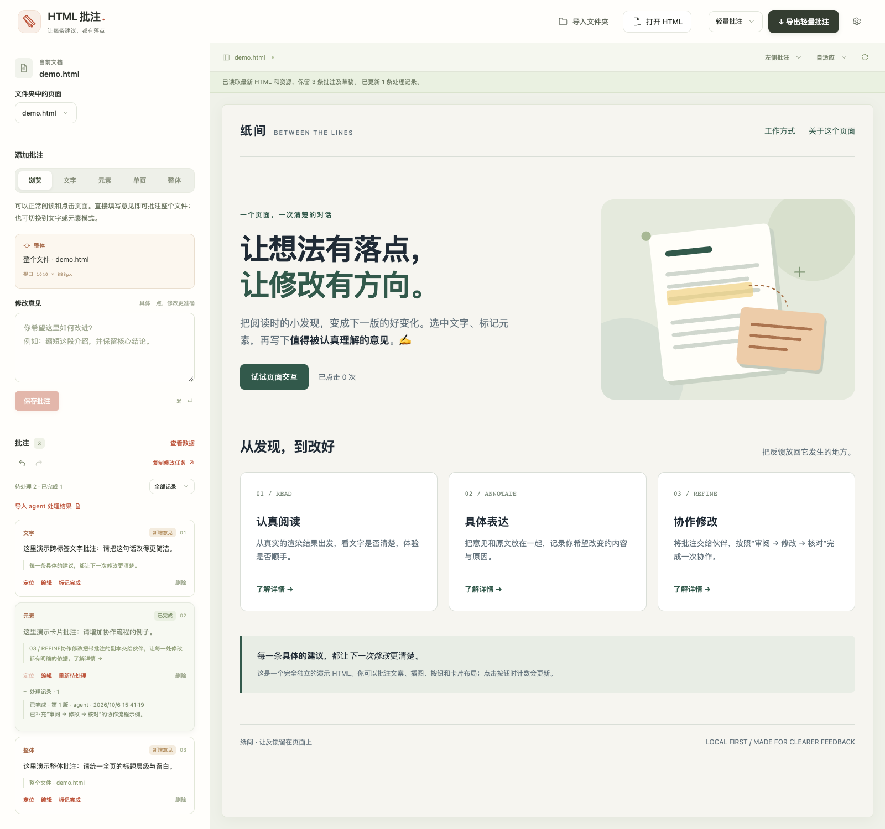

# HTML Review · 本地 HTML 批注

[English](README.en.md) · [快速开始](docs/QUICKSTART.md) · [Windows 使用](docs/WINDOWS.md) · [v0.1.0 发布说明](docs/releases/v0.1.0.md)

在 HTML 的渲染页面上写下“改哪里、改什么”，保存带原文和定位上下文的批注，交给人或 coding agent 修改。读取最新源文件、接收处理结果后，可继续下一轮审阅。

**下载一个 HTML 文件，用浏览器打开即可使用。** 无需安装、启动服务器、登录或配置 AI 服务。界面目前为中文，优先支持普通独立 HTML 页面。

## 下载与快速开始

首个公开测试版 **v0.1.0**。从 [Releases](https://github.com/King-A23/html-review/releases) 选择版本；以下为该版本的下载文件。

| 文件 | 用途 |
| --- | --- |
| [html-review.html](https://github.com/King-A23/html-review/releases/download/v0.1.0/html-review.html) | 单文件工具，下载后直接打开。日常使用选这个。 |
| [html-review-v0.1.0.zip](https://github.com/King-A23/html-review/releases/download/v0.1.0/html-review-v0.1.0.zip) | 离线套件，包含工具、示例、agent 交接脚本和文档。使用脚本需要 Python 3。 |
| [SHA256SUMS.txt](https://github.com/King-A23/html-review/releases/download/v0.1.0/SHA256SUMS.txt) | 用于核对上述文件的 SHA-256。 |

1. 用现代桌面浏览器打开下载的 **`html-review.html`**，推荐 Chrome 或 Edge。也可下载或克隆源码，直接打开根目录 **`index.html`**。
2. 点击**体验一份审阅示例**，或**打开 HTML**。页面带本地图片、样式或脚本时，选择**导入文件夹**。
3. 切换到**文字、元素、单页或整体**，写下意见并点击**保存批注**。
4. 点击**下载批注副本**保留审阅结果；点击**复制修改任务**，连同原始 HTML 与相关资源交给 agent。

工具只读原文件，自动保存也不会写回原文件。下载的 `.review.html` 可直接打开继续编辑；本机恢复记录依赖浏览器存储，长期保留请下载副本。完整操作与 agent 回传流程见[快速开始](docs/QUICKSTART.md)。


## 完整使用流程

1. 打开下载的 `html-review.html`，或源码根目录 `index.html`，用现代桌面浏览器使用。推荐先用 Chrome 或 Edge 验证完整流程。
2. 首次打开会显示三步引导。点击**体验示例**查看三条可定位、编辑的示范批注，或点击**打开 HTML**、直接拖入一个本地 `.html` 文件，例如 `examples/demo.html`。文件只会被读取，工具不会覆盖它。
3. 在渲染结果上添加批注：
   - **文字**：拖选文字，再填写修改意见。点击目标卡片的**取消选择**，或在预览中点击使文字选区取消，可清除目标并保留已填写的意见；重新选择后再保存。适合替换文案、修改句子或解释术语。
   - **元素**：点选图片、按钮、卡片等元素，再填写修改意见。点击**选父级容器**可向外选择整张卡片或区块，适合明确指出布局区域。
   - **单页**：对 HTML 已有的幻灯片或打印页区块提出意见。在预览中点击，或从页码列表选择；可用 `examples/pages.html` 体验。识别分页类名、data-page/data-slide、幻灯片 section 与明确的 CSS 分页边界。连续页面没有分页结构时，请使用元素或整体批注。
   - **整体**：针对当前整个 HTML 文件提出意见，无需选择文字或元素。打开文件后可在浏览模式直接填写并保存，也可点击**整体**。适合全文内容、结构、页面布局、配色和响应式需求；不包含文件夹中的其他入口页面。
   - **浏览**：使用页面按钮和页内锚点等交互，也可直接填写针对整个文件的意见；跨页链接会被阻止并提示。添加元素批注时再切换回元素模式。
4. 填写意见后点击**保存批注**，或按 `Ctrl+Enter` / `⌘+Enter`。在列表中查看、定位、编辑或删除批注；编辑后点击**更新批注**。添加、更新和删除均可撤销、重做（最近 50 次，刷新后不保留操作历史）。
5. 在顶部选择保存格式并下载，默认为可继续编辑的 HTML 副本，例如 `demo.review.html`。也可选择压缩副本或轻量批注，见下表。原始 HTML 保持不变。
6. 双击 HTML 副本，或重新导入本工具，即可继续查看、修改批注；压缩副本需先解压。轻量 JSON 供 agent 使用，不能单独恢复编辑工作区。
7. 点击**复制修改任务**，将任务文本和对应原始 HTML、资源交给 coding agent；或将**批注文件和对应的原始 HTML**交给 agent，配合 [`AGENT_PROMPT.md`](AGENT_PROMPT.md) 中的通用提示词使用。

**本机自动保存与下载分别显示状态。** 文件快照、批注、当前目标、编辑草稿及布局偏好使用浏览器 IndexedDB 保存，适用于较大的文件；显示“本机已保存”后，同一标签刷新会恢复。再次打开同一工具地址会提示选择恢复，不会直接替换已打开的其他版本副本。每个工具地址保留最近一个工作区，可用“清除本机恢复记录”移除。浏览器清理数据、隐私模式、存储权限或配额可能使恢复不可用，失败会提示；下载副本可用于长期保留和跨设备继续编辑。自动保存不会写回原文件。

未处理恢复提示时，导入另一文件会先说明并确认替换恢复记录。清除操作会暂停同地址标签中的旧保存任务；之后的新修改会重新保存。存储暂时失败时可点击**重试本机保存**。多个标签共用该地址最近一个工作区，适合单人审阅；并行编辑时请分别下载副本保留各自结果。

右上角**设置**统一包含**工作区、使用说明、快捷键**三个分区；工作区可选择批注栏放在左侧或右侧。快捷键随时可查看：`Ctrl/⌘+O` 打开、`Ctrl/⌘+S` 下载、`Ctrl/⌘+Enter` 保存批注，`V/T/E/P/A` 切换浏览/文字/元素/单页/整体，`Esc` 依次关闭弹窗、取消选择或退出编辑，`Ctrl/⌘+Z` 撤销、加 `Shift` 重做，`?` 打开面板。主界面与预览内都可使用；输入控件保留文字输入和原生撤销，模式键只在输入控件外生效。引导收起后可在使用说明中重新显示。

菜单从触发按钮附近展开，设置面板与背景渐入；连续开合会从当前进度反向播放。设置分区平滑交接，保存后有短暂确认与卡片展开反馈。尊重系统“减少动态效果”偏好，精简动效时仍可正常操作。

“当前文档”区域只显示文件名；文件大小、编码、资源和哈希仍保存在副本数据中，可通过**查看数据**检查。

批注编辑器与列表默认位于左侧，可通过预览工具栏的**批注栏**选择**左侧批注**或**右侧批注**，切换时保留当前预览、批注目标和未保存的意见。浏览器允许本地存储时会记住位置偏好，下载副本也会保留当前布局；窄屏时自动上下排列。原页面在独立 iframe 中渲染，页面样式不会扩散到批注界面。右上方**视口**可选择自适应、390px、768px 或 1280px；这些是预览页面的宽度，不是整个浏览器窗口的宽度。需要复现布局意见时先设好视口，再保存批注。**重载页面**会重新读取关联的原始 HTML；关联文件夹时也会更新 CSS、图片、脚本等本地资源。重载保留已保存的批注、未保存的意见、当前批注模式及撤销历史，并重置原页面脚本运行状态。

## 怎样写清楚批注

批注既保存人的修改意见，也保存文字或元素内容、定位线索及上下文。屏幕尺寸可以帮助复现布局，但屏幕坐标不是唯一的定位依据。

| 意图 | 建议方式 | 可直接采用的批注示例 |
| --- | --- | --- |
| 修改一句话 | 文字 | 将“具体的建议”改为“可执行的修改意见”，保留当前字体和强调样式。 |
| 调整一张卡片 | 元素 | 这张“协作修改”卡片的按钮与其他卡片底部对齐，卡片标题保持不变。 |
| 修改图片 | 元素 | 将这张流程插图的圆角改成 16px，宽度继续跟随容器。 |
| 调整整体布局 | 整体 | 桌面宽度下保持三列卡片；窄于 720px 时改成一列，每张卡片间距 16px。 |
| 同一句话出现多次 | 文字或元素 | 修改第三张卡片里的“了解详情”为“开始协作”，其他卡片不变。 |

尽量写出**目标、动作和希望保留的效果**。对于宽度、间距、顺序、颜色等布局反馈，写明条件和预期值会比“这里不太好看”更有效。整体批注应说明全文的修改目标；涉及具体区域时，可明确提到“顶部导航”或“页脚”，不要只写“这里”。

文字批注记录选中文字、前后文及 DOM 定位线索；元素批注记录元素内容与定位信息；单页批注记录实际分页区块、页码和定位信息；整体批注记录页面和视口上下文。页面变化导致定位线索失效或有歧义时，应结合原文与上下文核查，不要把自动定位当作源代码修改指令。

点击**定位**后，列表会显示原文核对成功、通过上下文重新定位、存在多个候选或无法确认目标等状态；有歧义或缺失时不会静默选中一个替代目标。**查看数据**可以检查 JSON 摘要，其中省略了 Base64 内容；完整字节快照在下载副本的数据块中。

## 批注状态与 agent 回传

批注列表支持**全部记录、待处理、已完成**筛选。agent 完成修改后，通过 [`scripts/update_review.py`](scripts/update_review.py) 按批注 ID 生成轻量处理结果 JSON；已关联文件夹时，预览的**重载页面**会读取原 HTML 旁边的同名 `.review-results.json`。也可点击列表的**导入 agent 处理结果**。回报只更新状态和处理说明，原文、意见与定位上下文继续保留；已完成记录不再要求定位已删除的原句。

新批注显示**新增意见**；收到未完成回报显示**待处理**；修改已有处理记录的意见显示**已更新**并重新进入待处理；完成后显示**已完成**。导出副本、轻量 JSON 与复制修改任务保留这些状态和历史，交接说明明确要求 agent 只处理未完成意见。没有回报的意见一直视为新增，不通过导出时间推测是否处理过。

每条意见有版本号。旧回报不能覆盖新意见，同一批结果重复重载不会重复追加记录。状态也可手动标记完成、重新待处理、撤销或重做。已完成由回报者标记，仍需结合实际修改核对。详细的命令、JSON 协议和读取权限说明见 [`docs/AGENT_RESULTS.md`](docs/AGENT_RESULTS.md)。



## 带相对资源的页面

独立 HTML 中内嵌的 CSS、JavaScript、SVG 和 `data:` 图片适合直接导入。

如果 HTML 引用了本地 CSS、JavaScript 或图片，使用**导入文件夹**，选择同时包含 HTML 及其资源的目录，再选择入口 HTML。例如选择 `examples/with-assets`，入口为 `index.html`。

```text
with-assets/
  index.html
  styles/
    main.css
    palette.css
  scripts/
    interactions.js
  images/
    landscape.svg
    dots.svg
```

导入文件夹会将所选目录中的文件收进批注副本，并为预览重写普通 `src`、`href` 以及 CSS `url()`、`@import` 中的相对路径。请选择只包含本页面所需文件的目录；分享副本时，已收录的资源也会一并分享。

浏览器通过文件选择器授权读取文件，不能仅凭一个本地 HTML 的路径访问旁边的整个磁盘目录。只导入 HTML 文件时，其相对资源可能缺失。选择的目录需要覆盖资源路径；`../` 指向所选目录之外的文件不会被自动读入。

**查看 agent 的修改：** 在支持文件访问 API 的浏览器中（如 Chrome、Edge），通过“打开 HTML”或“导入文件夹”选择文件时，会建立只读关联。agent 修改原文件后，直接点击预览右上角的重载按钮即可读取最新内容，无需重新打开 HTML 或导入文件夹。关联会随本机工作区保存；刷新工具后可以继续重载，浏览器可能要求重新授权读取。文件夹关联建立后，打开其中其他 HTML 也会保留配套资源。

旧工作区、拖入的文件与下载副本只携带快照，没有磁盘读取权限：第一次重载需选择对应原文件；带本地资源时选择包含原文件和资源的文件夹，此后可直接重载。不支持文件访问 API 的浏览器每次重载需选择一次文件或文件夹，批注与草稿仍会保留。工具不会写回原文件，磁盘关联也不会写入下载副本。读取权限被拒绝、原文件移走或导入校验失败时，当前工作区保持不变。

批注保留原文与定位上下文，重载不会自动删除已处理的意见。源内容改变后，点击批注的定位按钮核对新页面；目标无法确认时会提示。

HTML 的解码会参考 BOM 或 `meta charset`，未声明时按 UTF-8 处理。浏览器不支持的编码或与声明不符的内容会提示错误；此时建议先另存为 UTF-8。无论预览采用何种文本编码，源文件快照与 SHA-256 均以原始字节为准。

界面的导入限制如下，`MiB` 表示 1,048,576 字节：

| 输入 | 上限 |
| --- | --- |
| 原始 HTML | 20 MiB。 |
| 整个文件夹 | 合计 50 MiB、最多 500 个文件；其中入口 HTML 仍限 20 MiB，单个资源限 40 MiB。 |
| 已下载的批注副本 | 整个 `.review.html` 文件可重新导入的上限为 100 MiB；其中原文件快照仍限 20 MiB。 |

Base64 和批注界面会让副本比原文件与资源的合计体积更大，原始 HTML 的 20 MiB 限制不能用于判断批注副本是否可重新导入。

外部网络资源仍依赖网络可达性。程序运行时拼接的 URL、`fetch()`/XHR、ES modules 的模块依赖、跨页面跳转、嵌套 iframe、服务器路由及必须同源运行的应用，不属于首版可靠支持范围。文件夹导入不等于运行开发服务器，也不会执行构建步骤。

## 下载的副本包含什么

顶部下载按钮旁可选择保存格式：

| 保存格式 | 包含内容 | 使用方式 |
| --- | --- | --- |
| HTML 副本 `.review.html` | 编辑界面、原文件和资源快照、完整批注。 | 可直接双击继续编辑；不需要原文件即可查看快照。 |
| 压缩副本 `.review.html.gz` | 完整 HTML 副本的 gzip 压缩结果。 | 解压得到 HTML 后继续编辑；检查器可直接读取压缩文件。压缩率取决于内容。 |
| 轻量批注 `.review.json` | 文件名、版本哈希等元数据、资源路径和哈希、完整批注；不含文件或资源快照、编辑界面。 | 与原始 HTML 和相关资源一起交给 agent；不能独立预览或恢复编辑工作区。 |

HTML 保存时不再携带工具内置示例，批注 JSON 使用紧凑格式；原文件与资源的字节快照保持完整。小文件的副本增量主要来自离线编辑界面；大文件的增量还包含 Base64 编码带来的约三分之一体积。压缩副本可减少保存和传输体积，轻量 JSON 则直接省去这些快照与工具代码。

**文件体积与 agent 的上下文占用取决于读取方式。** 请让 agent 运行 `scripts/inspect_review.py`，只把它输出的批注和元数据放入上下文，不要直接打印整份 HTML、gzip 或 Base64 内容。轻量 JSON 本身可直接解析；仍需校验配套原文件版本。

批注副本是一份自包含的**批注工作区 HTML**：它携带批注界面、原页面字节、已导入的本地资源和批注数据。原页面在隔离预览中渲染，副本不是把工具栏直接插进原文件后覆盖保存。

结构化数据内嵌在副本的一个 JSON 数据块中：

```html
<script type="application/json" id="html-review-data">
  …
</script>
```

完整副本的主要字段如下。轻量 JSON 使用 `format: "html-review-annotations"`、`schemaVersion: 1`，保留下列元数据和完整 `annotations`，但省略 `source.base64` 与所有资源的 `base64`：

| 字段 | 说明 |
| --- | --- |
| `format` | 固定为 `html-review`。 |
| `schemaVersion` | 当前为 `1`。读取器应检查版本。 |
| `source.name`、`source.path` | 原文件名称和相对所选目录根部的路径（使用 `/` 分隔，不包含所选文件夹名称或磁盘绝对路径），用于区分文件。 |
| `source.byteLength`、`source.lastModified` | 原文件字节数，以及文件选择器提供的最后修改时间（Unix 毫秒；未知时为 `null`）等版本线索。 |
| `source.sha256` | **原始文件字节**的 SHA-256，用于校验 agent 拿到的原文件是否为批注时的版本。不是整个批注副本的哈希。 |
| `source.encoding` | 渲染原文件所用的文本编码。 |
| `source.base64` | 原始文件字节的 Base64 表示，保留批注创建时的源文件快照。 |
| `resources` | 已导入资源列表，每项包含 `path`、`mime`、`base64`、`sha256`。 |
| `annotations` | 批注列表。 |
| `annotations[].id` | 批注唯一标识，用于反馈修改结果。 |
| `annotations[].kind` | `text`（文字）、`element`（元素）或 `page`（单页或整体，由 `target.scope` 区分）。 |
| `annotations[].comment` | 用户填写的修改意见。 |
| `annotations[].revision`、`status` | 意见版本，以及 `open`（待处理）/`resolved`（已完成）；旧记录默认第 1 版、待处理。 |
| `annotations[].history` | 对应意见版本的处理者、时间、状态与说明；不会覆盖原文与定位。 |
| `annotations[].taskState` | 轻量导出、复制任务与静态检查器中的派生状态：`new` / `updated` / `pending` / `completed`。 |
| `annotations[].createdAt`、`updatedAt` | 意见创建和最后修改时间；agent 回报不改变意见版本或该时间。 |
| `annotations[].target` | 相应类型的定位、原文、元素和上下文数据。读取时应检查实际字段。 |
| `annotations[].view` | 保存该批注时的预览视口 `width`、`height` 和 `devicePixelRatio`。 |

文字、元素和单页目标的主要定位字段包括：

| `target` 内的字段 | 含义 |
| --- | --- |
| `selector`、`domPath` | 元素 CSS 选择器，以及从 `document.documentElement` 开始的索引数组路径。`domPath` 每一级遍历元素子节点并排除工具拥有的节点。 |
| `tag`、`id`、`classes`、`attributes` | 元素标签、标识、类名以及 `alt`、`src`、`href` 等辅助属性。资源属性会尽量保留原相对路径供 agent 核对。 |
| `text` | 文字批注中为选中文字的精确快照；元素批注中为规范化空白后元素文本的前 1,600 个 UTF-16 码元。 |
| `quote.exact`、`quote.prefix`、`quote.suffix` | 文字批注中为精确原文及其在文本流中的前后文（各最多 72 个 UTF-16 码元），用于确认目标并区分重复文字。 |
| `textLength`、`textFingerprint` | 元素批注中为规范化空白后的完整元素文本长度与指纹；文字批注中这两项描述选区共同祖先元素的规范化文本，不能当作选中文字的长度或哈希。该指纹不是 `source.sha256`。 |
| `context.ancestor`、`context.siblingBefore`、`context.siblingAfter` | 祖先与相邻元素的上下文。 |
| `range.start`、`range.end` | 文字范围的起止 `path` 与 `offset`。路径从 `document.documentElement` 开始，逐级遍历含文本节点的 `childNodes` 并排除工具拥有的节点；`offset` 遵循 DOM Range 的节点内偏移。 |
| `position.start`、`position.end` | 下述文本流中的 UTF-16 偏移，不能直接当作源文件字节位置。 |
| `rect` | 批注时的元素或文字范围矩形，包含视口中的 `x/y/width/height` 和 `scrollX/scrollY`，以 CSS 像素计；用于辅助理解位置。 |

文字定位的文本流由 `body` 中合格文本节点按 DOM 顺序直接拼接而成，排除 `script`、`style`、`head`、`noscript`、`template` 及工具拥有的内容；拼接过程不压缩空白，也不根据 CSS 可见性筛选。因此这些偏移不是 HTML 源码偏移，也不是浏览器复制出的纯文本偏移。对于 emoji，UTF-16 码元数还可能与用户看到的字符数不同。

单页目标使用 `kind: "page"`、`scope: "page"`，保存 1 起始的 `pageIndex`、`pageCount`、`pageTitle`，以及分页区块的选择器、DOM 路径、内容指纹和上下文。页码仅供理解范围，定位应核对实际区块内容；隐藏幻灯片会提示先切换到对应页。嵌套幻灯片以末级分页区块为目标，切换页时的 active/present/past/future/current/is-active 状态类不影响内容核对。

整体目标覆盖当前整个 HTML 文件，继续使用 `kind: "page"`、`scope: "whole-document"`、文件名 `text`（旧副本可能为页面标题）、`context.sourcePath` 和 `viewport`。复现保存批注时的布局，读取该批注的 `view`；保存时也会将整体 `target.viewport` 同步为当前视口。

原文件字节是版本比对的依据，页面运行后产生的 DOM 可能与磁盘源码不同。CSS 选择器和 DOM 路径是辅助线索，agent 还应核对选中原文、相邻内容、元素属性及源码。

## 交给 coding agent

使用 [`AGENT_PROMPT.md`](AGENT_PROMPT.md) 提供的完整提示词。最短流程是：

1. 运行 `python3 scripts/inspect_review.py "批注文件" "原始.html"`，静态提取批注并校验版本；完整 HTML、gzip 副本和轻量 JSON 都支持。不要将完整工作区或 Base64 放进上下文。
2. 完整副本会在脚本中解码并校验原文件和资源快照；轻量 JSON 没有快照，需要提供配套原文件和资源。
3. 检查脚本的版本校验结果。版本不一致时先报告差异并重新核对定位；脚本输出保留完整批注和定位上下文。
4. 按批注原文、元素内容、选择器与上下文定位源代码；定位失效或目标有歧义时说明情况，避免猜测修改。
5. 仅处理 `status=open` 的意见，修改原始 HTML 或相应资源、验证效果；按批注 ID 生成处理结果 JSON，已完成记录仅供参考。结果接口见 [`docs/AGENT_RESULTS.md`](docs/AGENT_RESULTS.md)。

如果批注要求修改外部 CSS 或 JavaScript，请同时交给 agent 对应的原项目文件。副本内的资源快照可辅助核对，但实际交付应修改原项目中的文件。

本工具不自动调用 agent，不执行自然语言修改意见，也不自动修改源文件。

## 示例与验证

- [`examples/demo.html`](examples/demo.html)：无外部依赖，包含中文、emoji、跨行内元素文字、重复文案、三列卡片、内嵌 SVG，以及可点击按钮。
- [`examples/pages.html`](examples/pages.html)：三个已有打印页，适合体验单页与整体范围的区别。
- [`examples/demo.review.html`](examples/demo.review.html)：实际下载得到的可编辑批注副本，含文字、卡片区域和整体布局三类反馈，直接打开即可继续使用。
- [`examples/finance/index.html`](examples/finance/index.html)：使用虚构金融数据的测试页，含跨标签和重复文字、SVG 图标/图表、两张图片、表格、嵌套卡片和输入控件；测试要点见该目录 README。
- [`examples/with-assets/index.html`](examples/with-assets/index.html)：外部 CSS、CSS `@import`、CSS 背景图片、相对路径 SVG 和外部 JavaScript，用于检查文件夹导入。

首版已经实际完成浏览器闭环验证，记录与覆盖范围见 [`VERIFICATION.md`](VERIFICATION.md)。仓库也提供 [`scripts/inspect_review.py`](scripts/inspect_review.py)，可以静态读取批注并检查原文件版本：

```sh
python scripts/inspect_review.py demo.review.html demo.html
python scripts/inspect_review.py demo.review.html.gz demo.html
python scripts/inspect_review.py demo.review.json demo.html
```

可用以下步骤手动验证完整保存闭环：

1. 导入 `demo.html`，在文字模式中选中跨行内标签的“具体的建议，都让下一次修改更清楚”，保存一条文案批注。
2. 在元素模式中点击“协作修改”卡片，保存一条元素批注；再添加一条带断点、列数和间距要求的整体批注。
3. 在浏览模式中点击“试试页面交互”，确认计数会变化。
4. 下载 `demo.review.html`，关闭预览后直接打开这个下载文件，确认三条批注和原页面仍可查看。
5. 修改一条批注、删除一条、再新增一条，再次下载并重新打开，核对实际内容与数量。
6. 将副本重新导入根目录工具，核对批注；使用提示词中的提取脚本确认源文件字节哈希一致。
7. 导入 `with-assets` 文件夹，确认样式、SVG、CSS 背景图片和按钮交互，下载并重新打开检查资源仍有效。

## 开发与测试

开发需 Node.js 20+；涉及静态检查器、agent 回报及发布打包时需 Python 3.8+。使用成品 `html-review.html` 或 `index.html` 不需要这些运行环境。先在仓库根目录安装锁定的开发依赖：

```sh
npm ci
npm run build
npm run check
npm test
```

构建会从 `src/` 生成根目录 `index.html`。修改源代码后应重新构建，将源代码与生成的单文件产物一起提交。实际浏览器操作验证用于确认选择、下载、重新打开等行为；单元测试不能替代这个闭环。

浏览器端到端测试使用锁定版本的 Playwright。安装开发依赖后，首次下载 Chromium，再运行各套件：

```sh
npx playwright install chromium
npm run test:bridge
npm run test:session
npm run test:e2e
npm run test:usability
npm run test:ui
npm run test:motion
npm run test:reload
npm run test:results
```

常规测试通过本地 `file://` URL 打开工具和下载副本，无需启动 HTTP 服务器。重载和处理结果专项测试会启动并关闭一个临时本机 HTTP 服务，使用 Chromium 原生文件系统句柄验证新内容读取、目录关联和 IndexedDB 恢复；文件选择器返回测试句柄，不操作系统选择窗口。兼容路径使用实际磁盘文件和目录选择事件。已有浏览器和 Playwright 的环境可用 `BROWSER_PATH` 指定浏览器可执行文件，或用 `PLAYWRIGHT_MODULE_PATH` 指定现有 Playwright 包的绝对目录或 `index.mjs` 入口文件；会话测试还支持 `.js` 入口与 `file:` URL。未设置时使用已安装的 Playwright 与它的 Chromium。例如在 PowerShell 中：

```powershell
$env:PLAYWRIGHT_MODULE_PATH = 'C:\path\to\node_modules\playwright'
$env:BROWSER_PATH = 'C:\Program Files (x86)\Microsoft\Edge\Application\msedge.exe'
node tests/e2e.mjs
```

将示例路径替换成实际安装位置；仅在使用已有测试依赖或浏览器时需要设置这些变量。

GitHub Actions 在推送、PR 和手动运行时，在 Windows 与 Linux 上用 Node.js 20 与 24 检查生成文件、单元测试和上述浏览器套件，并保存测试报告与截图。Linux 首次安装浏览器依赖可执行 `npx playwright install --with-deps chromium`。

## 可选：命令行打开

需要 Node.js 20+。在源码仓库根目录运行 `npm ci`，再用 `npm link` 注册命令：

```sh
html-review                  # 打开空白批注工具
html-review "./报告.html"     # 生成同目录的批注副本并打开
html-review "./报告.review.html" # 继续编辑已有批注
html-review "./报告.html" --no-open # 仅生成副本并输出路径
```

macOS 默认使用 Google Chrome；Windows/Linux 使用系统默认浏览器。
命令不会覆盖已有文件：同名副本已存在时生成 `.review.1.html` 等新文件。
生成的副本包含原文件快照；批注后仍需点击“下载批注副本”保存。
外部 CSS、图片、JS 不会由命令自动收录，请运行无参数命令后使用“导入文件夹”。

## 已知限制

- **仅导入可信 HTML。** 原页面脚本在不授予同源权限的 sandbox iframe 中运行，原页面与批注界面隔离；页面和资源仍可能发起网络请求。该隔离不是离线保证，也不是恶意文件分析环境。
- 首版面向现代桌面浏览器。文件夹选择、下载策略、`file://` 行为可能因浏览器或企业策略不同而有差异。
- 交互脚本可以继续运行，因此页面计时器、随机内容、运行时修改 DOM、延迟加载和字体加载可能影响定位。批注副本保留的是原始 HTML 字节及批注，不是浏览器运行状态的完整录像。
- Shadow DOM、canvas 内的绘图文字、跨 iframe 内容和图片中的文字无法像普通 DOM 文本一样定位。可以对外层元素或整体写出明确意见。
- 页面样式会影响实际可见内容；隐藏元素、响应式布局和不同视口可能让目标暂时不可见。整体意见应写明布局条件。
- 采用 Base64 收录资源会增加文件体积；大量图片、视频和复杂应用会让导入与下载变慢。本机自动保存依赖浏览器存储；尚无多人协同编辑。
- 工具尽量保留原页面样式和交互，但 sandbox、资源重写和浏览器本地文件策略可能影响依赖服务器或同源能力的页面。
- 为使批注桥接脚本运行并避免预览自动跳走，原页面的 CSP 和 refresh `meta` 会在预览时移除并给出提示；原文件字节快照保持原样。表单提交、登录、存储和跨页跳转也受 sandbox 限制。
- 哈希用于识别版本与检查快照一致性，不是数字签名。收到的批注仍需由人或 agent 审阅。

## 许可证与反馈

项目采用 [MIT 许可证](LICENSE)。v0.1.0 为 public beta；支持范围、界面与数据接口仍可能在后续版本调整。反馈问题时，请提供浏览器版本、复现步骤和可公开的最小 HTML 示例；不要附带未经处理的私人文件或资源。可通过 [GitHub Issues](https://github.com/King-A23/html-review/issues) 反馈。
